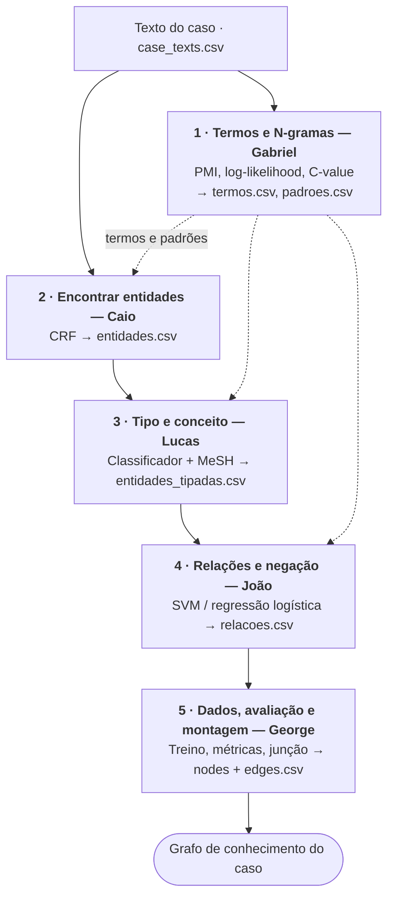
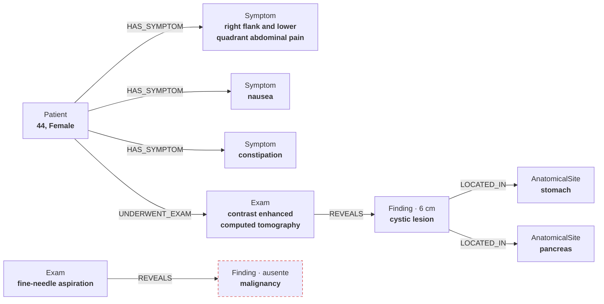

# Projeto 2 · Divisão do trabalho

O projeto 2 é a mesma linha de montagem do projeto 1, com cada estação ganhando uma versão que aprende com os dados. Cada membro cuida de uma estação, e toda estação tem duas versões intercambiáveis: a do projeto 1 (regras) e a do projeto 2 (estatística e aprendizado de máquina, sem LLMs nem embeddings).

## Visão geral



O texto desce pela coluna principal e vira grafo; os termos e padrões do Gabriel entram como pista nas estações 2, 3 e 4. Cinco regras deixam cada um trabalhar sem esperar os outros:

1. **Combinar os formatos primeiro.** Antes de qualquer código, a equipe fecha o arquivo que cada estação recebe e entrega (tabela abaixo). É a única tarefa que exige todo mundo junto.
2. **Toda estação tem a versão do projeto 1.** Enquanto a estação anterior não fica pronta, a saída do projeto 1 serve de mock. Na montagem final é só trocar a peça.
3. **Gabarito feito por todos.** Cada pessoa anota à mão 1 ou 2 casos (8 a 10 no total), para medir acerto e não só volume.
4. **Uma métrica só.** Todos medem com o script comum do George, para os números serem comparáveis.
5. **Cada estação faz sua comparação.** Regras × aprendizado e com × sem N-gramas: cinco experimentos pequenos e um grande, a linha inteira.

## Arquivos entre estações

Todos os mocks vêm de saídas que o projeto 1 já produz, então ninguém precisa inventar dados falsos.

| Arquivo | Conteúdo | Quem produz | Mock disponível hoje |
| --- | --- | --- | --- |
| `case_texts.csv` | `case_id, case_text` | já existe (`project1/data/case_texts.csv`) | — |
| `termos.csv` | `termo, n, frequencia, pmi, c_value` | Gabriel | lista vazia (as estações funcionam sem ela) |
| `padroes.csv` | `padrao, relacao, score` | Gabriel | gatilhos das arestas do projeto 1 (`trigger=` em `*-edges.csv`) |
| `entidades.csv` | `case_id, ent_id, char_start, char_end, texto` | Caio | blocos do `pos_bio.py` do projeto 1, que já têm offsets |
| `entidades_tipadas.csv` | `entidades.csv` + `type, concept_code, confianca` | Lucas | tipos do léxico do `pos_bio.py` + gazetteer MeSH do projeto 1 |
| `relacoes.csv` | `case_id, source, target, relation, polarity, certainty, confianca` | João | arestas de `project1/data/processed/*-edges.csv` |
| `silver/` e `gold/` | treino gerado pelas regras e anotação manual | George | — |

## Gabriel — Termos e N-gramas

- **Para que serve:** descobrir, só contando palavras, quais sequências formam um termo único (`heart rate`, `myocardial infarction`) e quais expressões costumam ligar duas coisas (`secondary to`, `treated with`). É o vocabulário que o resto da linha usa.
- **No grafo:**
  - **Nós inteiros:** um nó deve ser `myocardial infarction`, e não dois nós soltos `myocardial` e `infarction`.
  - **Arestas:** as expressões de ligação indicam que tipo de aresta existe entre dois nós.
  - Evita erros como o do projeto 1, em que `heart rate` virou o nó "parte do corpo: heart".
- **Técnica:** contagem de N-gramas (1 a 4) com medidas de associação: **PMI** e **log-likelihood** para pares e **C-value** para termos de várias palavras. Filtra antes por padrão de classe gramatical (ex.: adjetivo + substantivo). Pode usar o corpus completo do MultiCaRe baixado na #21 para ter estatística suficiente.
- **Input:** `case_texts.csv` e o corpus ampliado.
- **Output:** `termos.csv` (termos compostos ranqueados) e `padroes.csv` (expressões entre entidades associadas a cada relação).
- **Depende de:** ninguém. O filtro por classe gramatical usa o tagger do projeto 1 diretamente. Para o `padroes.csv`, usa como mock as arestas do projeto 1, até a estação do João existir.
- **Relação com o projeto 1:** **reaproveitado e incrementado.** O tokenizador regex clínico vira a etapa de entrada dos N-gramas. A comparação de tokenizadores do projeto 1 se repete: os termos descobertos mudam conforme o tokenizador?

**Exemplo.** Os exemplos de todas as estações seguem o mesmo trecho real do caso `PMC5137649_01`. Os números de frequência e score são ilustrativos.

Entrada (`case_texts.csv`, trecho):

```text
She underwent contrast enhanced computed tomography, demonstrating a 6cm cystic lesion between the stomach and body/tail of the pancreas (Fig 1).
```

Saída (`termos.csv`):

```csv
termo,n,frequencia,pmi,c_value
computed tomography,2,148,9.1,312.4
contrast enhanced computed tomography,4,21,7.8,96.0
cystic lesion,2,37,6.4,58.2
```

Saída (`padroes.csv`):

```csv
padrao,relacao,score
demonstrating,REVEALS,0.82
between the,LOCATED_IN,0.61
suggesting the diagnosis of,DIAGNOSED_WITH,0.77
```

## Caio — Encontrar entidades

- **Para que serve:** marcar no texto **onde** cada coisa relevante começa e termina, sem ainda dizer o que ela é. Em "The colonoscopy showed extensive colitis", aponta `colonoscopy` e `extensive colitis`.
- **No grafo:**
  - **Candidatos a nó:** decide quais pedaços do texto podem virar nós. O que esta etapa não marca nunca vira nó.
  - **Rótulo:** a fronteira define o `label` do nó.
  - **Auditoria:** os offsets permitem verificar cada nó no texto original.
- **Técnica:** **CRF** (Conditional Random Fields), que marca cada palavra como início, meio ou fora de uma entidade (BIO). Pistas: a palavra, prefixos e sufixos, formato, classe gramatical do HMM, palavras vizinhas (N-gramas) e "faz parte de um termo do `termos.csv`".
- **Input:** `case_texts.csv`, `termos.csv` e o material de treino de `silver/`.
- **Output:** `entidades.csv` e a versão CoNLL.
- **Depende de:**
  - **Gabriel:** mock com `termos.csv` vazio; o modelo roda sem essa pista e depois mede o ganho quando ela entra.
  - **George:** o treino vem do `silver/`; como mock, o próprio Caio gera o treino com o `pos_bio.py`.
- **Relação com o projeto 1:** **reaproveitado e incrementado.** O HMM e o tokenizador viram fornecedores de pistas para o CRF. O `pos_bio.py` passa a ser o "professor" (gera o treino) e a base de comparação (regras × CRF). As regras de reparo (`repair_tags`) e a gramática de blocos continuam como baseline.

**Exemplo.** Os offsets são os reais no `case_text`.

Entrada (`case_texts.csv`, trecho; `termos.csv` da estação 1):

```text
She underwent contrast enhanced computed tomography, demonstrating a 6cm cystic lesion between the stomach and body/tail of the pancreas (Fig 1).
```

Saída (`entidades.csv`):

```csv
case_id,ent_id,char_start,char_end,texto
PMC5137649_01,t1,282,319,contrast enhanced computed tomography
PMC5137649_01,t2,337,354,6cm cystic lesion
PMC5137649_01,t3,367,374,stomach
PMC5137649_01,t4,396,404,pancreas
```

Saída (versão CoNLL, início do trecho):

```text
underwent    VERB  O
contrast     ADJ   B-ENT
enhanced     ADJ   I-ENT
computed     ADJ   I-ENT
tomography   NOUN  I-ENT
,            PUNCT O
demonstrating VERB O
```

## Lucas — Tipo e conceito

- **Para que serve:** dizer **o que** cada entidade é (doença, sintoma, exame, remédio, parte do corpo...) e ligá-la a um código oficial do MeSH, para que grafias diferentes da mesma coisa se reconheçam.
- **No grafo:**
  - **Tipo:** dá o `type` de cada nó; sem ele, o nó não entra no grafo. Hoje 86% dos blocos ficam de fora por falta de tipo.
  - **Validação das arestas:** o tipo dos dois nós restringe que arestas fazem sentido (sintoma → diagnóstico pode, remédio → parte do corpo não).
  - **Ligação entre casos:** o código MeSH cria o nó `Concept` e a aresta `SAME_AS`. É isso que liga `T2DM` em um caso a `type 2 diabetes mellitus` em outro.
- **Técnica:** dois modelos:
  1. **Regressão logística** ou **Naive Bayes** com TF-IDF de N-gramas de caracteres e de palavras do contexto, para dar tipo aos blocos que o léxico não cobre.
  2. Ligação ao MeSH por **similaridade de N-gramas de caracteres (TF-IDF + cosseno)**, comparada ao `rapidfuzz` do projeto 1.
- **Input:** `entidades.csv`, `case_texts.csv` e o gazetteer MeSH do projeto 1.
- **Output:** `entidades_tipadas.csv`.
- **Depende de:**
  - **Caio:** mock com os blocos do `pos_bio.py`.
  - **George:** o treino vem do `silver/`; como mock, o próprio Lucas usa como exemplos os blocos que o léxico já tipou.
- **Relação com o projeto 1:** **reaproveitado e incrementado.** O gazetteer MeSH e o casamento exato continuam como primeira tentativa; o classificador entra só quando eles falham. O casamento aproximado (`rapidfuzz`) vira o baseline contra o qual a similaridade nova é medida.

**Exemplo.** Os códigos vêm dos gazetteers do projeto 1; as confianças são ilustrativas. `cystic lesion` não tem código no gazetteer: recebe o tipo pelo classificador, mas fica sem `Concept`.

Entrada (`entidades.csv` da estação 2):

```csv
case_id,ent_id,char_start,char_end,texto
PMC5137649_01,t1,282,319,contrast enhanced computed tomography
PMC5137649_01,t2,337,354,6cm cystic lesion
PMC5137649_01,t3,367,374,stomach
PMC5137649_01,t4,396,404,pancreas
```

Saída (`entidades_tipadas.csv`):

```csv
case_id,ent_id,char_start,char_end,texto,type,concept_code,confianca
PMC5137649_01,t1,282,319,contrast enhanced computed tomography,Exam,D014057,0.93
PMC5137649_01,t2,337,354,6cm cystic lesion,Finding,,0.71
PMC5137649_01,t3,367,374,stomach,AnatomicalSite,ANAT001,0.98
PMC5137649_01,t4,396,404,pancreas,AnatomicalSite,ANAT002,0.98
```

## João — Relações e negação

- **Para que serve:** decidir se duas entidades estão ligadas e como ("pneumonia **secondary to** aspiration" → causa), e se cada entidade foi afirmada ou negada ("**no** fever" → febre ausente).
- **No grafo:**
  - **Arestas:** cria as arestas e o `relation` de cada uma. Sem esta etapa, o grafo é só uma lista de nós soltos.
  - **Polaridade e certeza:** preenche `polarity` e `certainty`, o que impede o grafo de afirmar o oposto do texto: "sem febre" não pode virar "tem febre".
- **Técnica:**
  - **Relações:** **SVM linear** e **regressão logística** sobre N-gramas (1 a 3) das palavras entre as duas entidades, mais os tipos das entidades e a distância.
  - **Negação e certeza:** um classificador separado sobre a janela de palavras ao redor da entidade.
- **Input:** `entidades_tipadas.csv`, `case_texts.csv`, `padroes.csv` e o treino de `silver/`.
- **Output:** `relacoes.csv`.
- **Depende de:**
  - **Lucas:** mock com nós e offsets reconstruídos das arestas do projeto 1.
  - **Gabriel:** mock com `padroes.csv` gerado dos gatilhos do projeto 1.
  - **George:** as arestas do projeto 1 servem de treino até o `silver/` sair.
- **Relação com o projeto 1:** **reaproveitado e incrementado.** A lista de proteção de 17 palavras de negação vira pista do classificador de negação e baseline dele. Os experimentos das 4 condições se repetem: aqui, remover stop-words do contexto ajuda ou destrói o classificador, como destruiu a extração? Os extratores por regra em si são descartáveis; viram só gerador de dados.

**Exemplo.** Entra um segundo trecho do mesmo caso, para mostrar a negação. As confianças são ilustrativas.

Entrada (`entidades_tipadas.csv` da estação 3 + o texto):

```text
She underwent [contrast enhanced computed tomography]t1, demonstrating a [6cm cystic lesion]t2 between the [stomach]t3 and body/tail of the [pancreas]t4 (Fig 1).
[FNA]t5 of the cyst demonstrated no evidence of [malignancy]t6 ...
```

Saída (`relacoes.csv`):

```csv
case_id,source,target,relation,polarity,certainty,confianca
PMC5137649_01,t1,t2,REVEALS,present,asserted,0.88
PMC5137649_01,t2,t3,LOCATED_IN,present,asserted,0.64
PMC5137649_01,t2,t4,LOCATED_IN,present,asserted,0.59
PMC5137649_01,t5,t6,REVEALS,absent,asserted,0.81
```

Na última linha, `no evidence of` faz a malignidade entrar no grafo como **ausente**, e não como achado.

## George — Dados, avaliação e montagem

- **Para que serve:** três papéis:
  1. **Fornecer os dados de treino** para os modelos de todos.
  2. **Medir** se cada estação melhorou em relação ao projeto 1.
  3. **Juntar** as saídas das estações em um único grafo por caso.
- **No grafo:**
  - **Montagem:** é quem constrói o grafo final em `nodes.csv` + `edges.csv`.
  - **Um nó por coisa:** junta menções repetidas da mesma coisa em um nó só (`the cyst` mencionado 5 vezes vira um nó, não cinco).
  - **Confiabilidade:** mede o quanto o grafo é confiável, comparando-o com o gabarito e com o grafo do projeto 1.
- **Técnica:** **supervisão fraca**: as regras do projeto 1 rotulam os textos e geram o treino. Divisão treino/validação/teste por caso. Métricas: precisão, revocação, F1 e matriz de confusão. Para juntar menções repetidas, **agrupamento por similaridade** (TF-IDF de N-gramas de caracteres + agrupamento hierárquico).
- **Input:** saídas do projeto 1 (para gerar o `silver/`), anotação manual de todos (`gold/`) e as saídas das quatro estações.
- **Output:** `silver/`, `gold/`, o script de métricas comum, o grafo final em `nodes.csv` + `edges.csv` (formato do projeto 1) e a tabela de comparação entre as combinações regras × aprendizado.
- **Depende de:** todos, na montagem final. Até lá, monta a linha inteira com as saídas do projeto 1 como mocks de cada estação e troca as peças conforme ficam prontas.
- **Relação com o projeto 1:** **reaproveitado e incrementado.** A normalização (NFKC, siglas, unidades) continua aplicada aos rótulos antes do agrupamento. O grafo `combinado` do projeto 1 é a base de comparação contra o grafo do projeto 2.

**Exemplo.** O agrupamento junta `6cm cystic lesion` e `the cyst`, que se repete ao longo do caso, em um nó só; o tamanho sai do rótulo e vira atributo.

Entrada (saídas das estações 3 e 4):

```csv
ent_id,texto,type,concept_code
t1,contrast enhanced computed tomography,Exam,D014057
t2,6cm cystic lesion,Finding,
t3,stomach,AnatomicalSite,ANAT001
t7,the cyst,Finding,
```

Saída (`nodes.csv`, formato do projeto 1):

```csv
case_id,node_id,type,label,attributes
PMC5137649_01,E1,Exam,contrast enhanced computed tomography,modality=imaging
PMC5137649_01,F1,Finding,cystic lesion,size=6 cm; polarity=present; mentions=t2|t7
PMC5137649_01,A1,AnatomicalSite,stomach,
PMC5137649_01,C1,Concept,"Tomography, X-Ray Computed",code=D014057
```

Saída (`edges.csv`):

```csv
case_id,edge_id,source_id,target_id,relation,attributes
PMC5137649_01,e1,E1,F1,REVEALS,evidence_text=demonstrating; char_start=321; char_end=334; certainty=asserted
PMC5137649_01,e2,F1,A1,LOCATED_IN,certainty=asserted
PMC5137649_01,e3,E1,C1,SAME_AS,
```

## Exemplo de ponta a ponta

Três frases reais do caso `PMC5137649_01` atravessam as cinco estações e viram 10 nós clínicos e 8 arestas. A saída de cada estação é a entrada da seguinte. Offsets e códigos MeSH são os reais; frequências, scores e confianças são ilustrativos.

### Entrada

```text
[0]   A 44-year-old woman presented with a 3-day history of right flank and lower quadrant abdominal pain associated with nausea and constipation.
[268] She underwent contrast enhanced computed tomography, demonstrating a 6cm cystic lesion between the stomach and body/tail of the pancreas (Fig 1).
[620] FNA of the cyst demonstrated no evidence of malignancy ...
```

### 1 · Gabriel — Termos e N-gramas

Recebe `case_texts.csv` (o corpus inteiro, não só este caso). Entrega às estações 2, 3 e 4 as linhas que importam para este trecho:

```csv
termo,n,frequencia,pmi,c_value
abdominal pain,2,212,8.3,401.7
computed tomography,2,148,9.1,312.4
cystic lesion,2,37,6.4,58.2
```

```csv
padrao,relacao,score
presented with,HAS_SYMPTOM,0.91
underwent,UNDERWENT_EXAM,0.86
demonstrating,REVEALS,0.82
demonstrated no evidence of,REVEALS,0.74
between the,LOCATED_IN,0.61
```

### 2 · Caio — Encontrar entidades

Recebe o texto e o `termos.csv`. O termo `abdominal pain` ajuda o CRF a manter `right flank and lower quadrant abdominal pain` como um bloco só. Entrega ao Lucas:

```csv
case_id,ent_id,char_start,char_end,texto
PMC5137649_01,t1,2,19,44-year-old woman
PMC5137649_01,t2,54,99,right flank and lower quadrant abdominal pain
PMC5137649_01,t3,116,122,nausea
PMC5137649_01,t4,127,139,constipation
PMC5137649_01,t5,282,319,contrast enhanced computed tomography
PMC5137649_01,t6,337,354,6cm cystic lesion
PMC5137649_01,t7,367,374,stomach
PMC5137649_01,t8,396,404,pancreas
PMC5137649_01,t9,620,623,FNA
PMC5137649_01,t10,627,635,the cyst
PMC5137649_01,t11,664,674,malignancy
```

### 3 · Lucas — Tipo e conceito

Recebe `entidades.csv`. O gazetteer resolve o que conhece; o classificador dá tipo a `cystic lesion` e `the cyst`, que ficam sem código. `FNA` só casa depois que a sigla é expandida para `fine-needle aspiration`. Entrega ao João:

```csv
case_id,ent_id,char_start,char_end,texto,type,concept_code,confianca
PMC5137649_01,t1,2,19,44-year-old woman,Patient,,0.97
PMC5137649_01,t2,54,99,right flank and lower quadrant abdominal pain,Symptom,D015746,0.90
PMC5137649_01,t3,116,122,nausea,Symptom,D009325,0.99
PMC5137649_01,t4,127,139,constipation,Symptom,D003248,0.99
PMC5137649_01,t5,282,319,contrast enhanced computed tomography,Exam,D014057,0.93
PMC5137649_01,t6,337,354,6cm cystic lesion,Finding,,0.71
PMC5137649_01,t7,367,374,stomach,AnatomicalSite,ANAT001,0.98
PMC5137649_01,t8,396,404,pancreas,AnatomicalSite,ANAT002,0.98
PMC5137649_01,t9,620,623,FNA,Exam,D044963,0.88
PMC5137649_01,t10,627,635,the cyst,Finding,,0.66
PMC5137649_01,t11,664,674,malignancy,Finding,D009369,0.85
```

### 4 · João — Relações e negação

Recebe `entidades_tipadas.csv`, o texto e o `padroes.csv`. Classifica cada par de entidades da mesma frase; os pares sem relação (`NONE`) não aparecem. `no evidence of` marca `malignancy` como ausente. Entrega ao George:

```csv
case_id,source,target,relation,polarity,certainty,confianca
PMC5137649_01,t1,t2,HAS_SYMPTOM,present,asserted,0.94
PMC5137649_01,t1,t3,HAS_SYMPTOM,present,asserted,0.92
PMC5137649_01,t1,t4,HAS_SYMPTOM,present,asserted,0.92
PMC5137649_01,t1,t5,UNDERWENT_EXAM,present,asserted,0.89
PMC5137649_01,t5,t6,REVEALS,present,asserted,0.88
PMC5137649_01,t6,t7,LOCATED_IN,present,asserted,0.64
PMC5137649_01,t6,t8,LOCATED_IN,present,asserted,0.59
PMC5137649_01,t9,t11,REVEALS,absent,asserted,0.81
```

### 5 · George — Montagem

Recebe `entidades_tipadas.csv` e `relacoes.csv`. Junta `t6` e `t10` (a mesma lesão) no nó `F1`, tira o tamanho do rótulo, troca os `ent_id` por `node_id` e cria um `Concept` por código MeSH. Entrega o grafo final no formato do projeto 1:

```csv
case_id,node_id,type,label,attributes
PMC5137649_01,P1,Patient,case PMC5137649_01,age=44; age_unit=years; gender=Female
PMC5137649_01,S1,Symptom,right flank and lower quadrant abdominal pain,polarity=present; duration=3 days
PMC5137649_01,S2,Symptom,nausea,polarity=present
PMC5137649_01,S3,Symptom,constipation,polarity=present
PMC5137649_01,E1,Exam,contrast enhanced computed tomography,modality=imaging
PMC5137649_01,E2,Exam,fine-needle aspiration,abbreviation=FNA
PMC5137649_01,F1,Finding,cystic lesion,size=6 cm; polarity=present; mentions=t6|t10
PMC5137649_01,F2,Finding,malignancy,polarity=absent
PMC5137649_01,A1,AnatomicalSite,stomach,
PMC5137649_01,A2,AnatomicalSite,pancreas,
PMC5137649_01,C1,Concept,Abdominal Pain,code=D015746
PMC5137649_01,C2,Concept,Nausea,code=D009325
PMC5137649_01,C3,Concept,Constipation,code=D003248
PMC5137649_01,C4,Concept,"Tomography, X-Ray Computed",code=D014057
PMC5137649_01,C5,Concept,"Biopsy, Fine-Needle",code=D044963
PMC5137649_01,C6,Concept,Neoplasms,code=D009369
```

```csv
case_id,edge_id,source_id,target_id,relation,attributes
PMC5137649_01,e1,P1,S1,HAS_SYMPTOM,trigger=presented with; certainty=asserted
PMC5137649_01,e2,P1,S2,HAS_SYMPTOM,trigger=presented with; certainty=asserted
PMC5137649_01,e3,P1,S3,HAS_SYMPTOM,trigger=presented with; certainty=asserted
PMC5137649_01,e4,P1,E1,UNDERWENT_EXAM,trigger=underwent; certainty=asserted
PMC5137649_01,e5,E1,F1,REVEALS,trigger=demonstrating; char_start=321; char_end=334
PMC5137649_01,e6,F1,A1,LOCATED_IN,trigger=between the
PMC5137649_01,e7,F1,A2,LOCATED_IN,trigger=between the
PMC5137649_01,e8,E2,F2,REVEALS,trigger=demonstrated no evidence of
PMC5137649_01,e9,S1,C1,SAME_AS,
PMC5137649_01,e10,S2,C2,SAME_AS,
PMC5137649_01,e11,S3,C3,SAME_AS,
PMC5137649_01,e12,E1,C4,SAME_AS,
PMC5137649_01,e13,E2,C5,SAME_AS,
PMC5137649_01,e14,F2,C6,SAME_AS,
```

Além das 8 arestas clínicas, saem 6 `SAME_AS` para os conceitos MeSH. O grafo segue para as métricas contra o gabarito e para o visualizador.

### Grafo resultante



Fora do desenho: 6 nós `Concept` (MeSH), ligados por `SAME_AS` aos 3 sintomas, aos 2 exames e a `malignancy`. A lesão encontrada na tomografia fica localizada entre estômago e pâncreas; a malignidade investigada pela FNA aparece tracejada porque foi negada no texto.

## Como as etapas constroem o grafo

| Etapa | Contribuição ao grafo |
| --- | --- |
| Gabriel | Nós de várias palavras e pistas para as arestas |
| Caio | Quais trechos do texto viram nós, e com qual rótulo |
| Lucas | O tipo de cada nó e a ligação entre casos (`Concept`, `SAME_AS`) |
| João | As arestas, com polaridade e certeza |
| George | O grafo montado, sem nós duplicados e com qualidade medida |

## O que acontece com o projeto 1

| Peça do projeto 1 | Destino |
| --- | --- |
| Tokenizador regex (Gabriel) | **Reaproveitado**: entrada dos N-gramas e das pistas do CRF |
| Normalização (George) | **Reaproveitada**: aplicada aos rótulos antes do agrupamento |
| Lista de proteção de negação (João) | **Reaproveitada**: pista e baseline do classificador de negação |
| Extratores de stop-words (João) | **Descartáveis**: viram só gerador de dados |
| Gazetteer MeSH (Lucas) | **Reaproveitado**: primeira tentativa antes do classificador |
| `rapidfuzz` (Lucas) | **Vira baseline** da similaridade por N-gramas de caracteres |
| HMM e gramática de blocos (Caio) | **Reaproveitados**: pistas do CRF, gerador de treino e baseline |
| Grafo `combinado` + visualizador | **Reaproveitados**: comparação final e exibição do grafo do projeto 2 |
